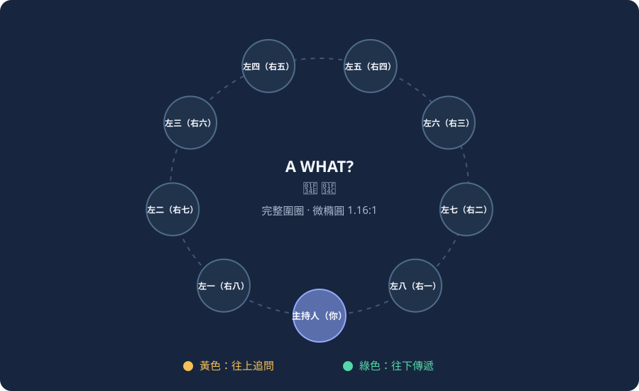

# A What? — Verbal Relay Simulator / 口語傳遞模擬器

An open-source bilingual (Traditional Chinese / English) role-playing simulator for the experiential-learning game **A What?** (also known as **Apple and Pineapple**). The original game is traditionally played in a circle, sometimes with physical props. **This simulator deliberately uses no props** and models verbal relay only.

> **Status: v0.1.3 prototype (macOS push-to-talk fixes).** Core dialogue logic and GUI have automated tests / smoke tests. Microphone recognition and real-world voice playback depend on your own operating system, voices, microphone, and installed local language models, so have not been verified on all devices.



**v0.1.1 layout:** the host sits at the bottom center of a close, nearly circular ring (1.16:1 oval). Left 1 appears left of the host and Right 1 appears on the right. The diagram depicts seating geometry; the live Tkinter display includes colored speech bubbles and controls. / **v0.1.1 版面：** 主持人在下方中央，大家貼近圍成一圈（寬高比 1.16:1）。左一在主持人左側，右一在右側。圖示為座位配置；實際程式另有發話燈號及操作按鈕。

**License:** MIT. No Vosk models or audio recordings are bundled. This project is an independent simulation of a group activity, not an official product of any activity author or training organization.

---

## 中文說明（繁體）

### 特色

- **九人圓圈**：預設八名虛擬參加者，加上主持人（你），合計九人。虛擬人數可調為 **3–16**。
- **同一人有兩種位置名稱**：例如左一＝右八、左二＝右七。畫面只畫一個圓圈，不會把同一個人算兩次。
- **六句固定台詞**：「這是蘋果」「這是香蕉」「蘋果」「香蕉」「什麼」「謝謝」。
- **顏色含義固定**：**黃色**表示「向訊息源頭／上一層」發問或致謝；**綠色**表示「向下一位」發起或傳遞答案。
- **逐層回問**：左二問「什麼」後，左一仍須再問「什麼」，直到問題抵達主持人；答案才逐層往外傳。
- **雙向運作**：可同時讓蘋果往左、香蕉往右，也可從同一方向再發起其他訊息。
- **可調反應時間**：每次虛擬人物輪到發話前，預設等待 **2.0 秒**，可設 0–10 秒。
- **可調語速**：預設 150（文字轉語音引擎的 rate 參數），可設 100–220。
- **中英文切換**：改變台詞、人物名稱與介面。內部以中立的語句代號處理邏輯，因此遊戲進行中也能切換。
- **訊息紀錄**：可匯出 CSV，觀察訊息順序與路徑。

### 如何啟動

需要 **Python 3.7 以上**及 Tkinter（一般 Python 桌面安裝已附）。只使用文字按鈕時，無需安裝其他套件。

```bash
python app.py
```

推薦先按左側「這是蘋果」，觀察「左一（右八）」的**黃色**「什麼」。此時按左側「蘋果」，你會依序看到左一說黃色「謝謝」、綠色「這是蘋果」，左二再說黃色「什麼」，左一回頭問黃色「什麼」，然後輪到你再次回答。

**左右按鈕：** 右側也有相同六句台詞，任何時候都可從另一方向啟動新訊息。當兩側都有待回答的問題時，你可以自己決定先回答哪一側。注意同一側有多筆等待時，v0.1 先用先進先出（FIFO）處理，避免「什麼」沒有辨識資訊時任意猜測其來源。

**鍵盤：** 用滑鼠按過左／右區塊即可選定方向，再按 `1`～`6` 代表該區的六句台詞（自上而下）。使用麥克風時，按住 `←` 或 `→` 鍵、說話後放開即可辨識。**v0.1.3 修正 macOS 長按方向鍵時的重複按鍵事件，避免錄音閃爍或被反覆中斷。**

**繞圈返回：** 當一條訊息傳到主持人的另一側，你須在該側說「什麼」，待問題循原路回到你原先發起的一側後再回答水果，最後在接收側說「謝謝」結束這條訊息。

### 讓人物開口說話（離線 TTS）

```bash
python -m pip install -r requirements-audio.txt
python app.py
```

打開「播放語音」，模擬人物便會嘗試使用作業系統的 TTS 語音說出六句話。**macOS v0.1.3 改用內建 `say` 指令，Mac 不必為了播放語音安裝 `pyttsx3`；其他系統仍可用 `pyttsx3`。** 必須有適當的中文或英文系統語音才能正確發音。聲音會排隊播放，不會同時從兩個喇叭發聲；在密集交會中，畫面事件可能比音訊快。

### 按住說話（離線麥克風辨識，可選）

```bash
python -m pip install -r requirements-microphone.txt
```

再從 [Vosk 官方語音模型頁](https://alphacephei.com/vosk/models) 下載適用的小模型，解壓縮到以下目錄（要直接看得到 `am`、`conf` 等子資料夾）：

```text
models/
  zh/    <- vosk-model-small-cn-0.22 解壓後的內容
  en/    <- vosk-model-small-en-us-0.15 解壓後的內容
```

- [中文小模型](https://alphacephei.com/vosk/models/vosk-model-small-cn-0.22.zip)（簡體中文辨識結果會轉成內部繁體台詞代號）
- [英文小模型](https://alphacephei.com/vosk/models/vosk-model-small-en-us-0.15.zip)

使用時：**按住左側或右側的「按住說話」區塊，說出六句之一，放開後辨識並提交**；也可按住鍵盤 `←`／`→`。**按住期間整場遊戲暫停**：所有虛擬角色、等待時間與畫面事件都凍結；Mac 上目前播放中的 `say` 語音會被中止，未播放的語音會清空。放開後仍暫停至語音辨識結束，再恢復傳話，不會把累積的事件一次快轉。**被中斷的聲音不會從中途續播**。建議戴耳機。

**中文辨識診斷：** 新版能處理部分繁／簡、分字與常見句型變化，受限詞彙無法解析時會再以一般詞彙解碼一次。下方提示會顯示 Vosk 原始辨識內容，例如 `辨識結果：这是苹果 → 這是蘋果`；若仍無法辨識，請記下顯示的 `grammar=...; free=...` 內容以利後續調整模型。這項改進仍需在你的 macOS 15.7.2 與中文口音環境實機確認。

**注意：Windows 7 / Python 3.7 / 32-bit** 的 GUI／文字控制可先使用，但離線語音辨識是否能安裝，取決於 `vosk` 與 `sounddevice` 是否提供相容的 32 位元套件。最新公開的 Vosk PyPI wheel 不一定有 Windows x86 版本。請不要把「可以執行 GUI」視為「已驗證在所有舊系統可用麥克風」。在較新 64-bit Windows、Mac 或 Linux 系統比較容易安裝。

### 驗證規則

```bash
python -m unittest discover -s tests -v
```

測試涵蓋逐層追問、先謝謝再轉送、左右位置對映、訊息繞回主持人、多方向傳遞、錯誤答案與重設。

### 目前版本的限制

1. 當同一側同時有數筆完全相同的「什麼」等待回答，模擬器以 FIFO 決定這句回應屬於哪一筆。這是規則的模糊性，並非語音辨識錯誤。
2. 人物說話的畫面事件依反應時間排列；TTS 由單一佇列依序播出，極端碰撞情況下不保證聲音和畫面毫秒級同步。
3. 未提供自動重播功能；目前可匯出 CSV 以分析活動。
4. 這是初版模擬器，尚未驗證多人實際帶領時的全部邊界情況。

---

## English

### Features

- A circular group with **eight simulated participants plus you** (nine total). Simulated participant count is configurable from 3 to 16.
- People have two names but a single seat: e.g. **Left 1 = Right 8**, **Left 2 = Right 7**.
- Exactly six phrases: **This is an apple**, **This is a banana**, **Apple**, **Banana**, **What?**, **Thank you**.
- **Yellow circles** mean a question or thanks directed **upstream**, toward the origin; **green circles** mean an introduction or answer directed **downstream**.
- Every new question travels back along the entire earlier relay chain to the host, and each answer travels out along the same chain.
- Both directions can be active concurrently; you may inject new messages on either side before older ones have completed.
- Default **2-second** reaction time (0–10 seconds adjustable), and default TTS rate **150** (100–220 adjustable).
- Chinese / English interface and phrases, plus CSV event export.

### Quick start

Python 3.7+ with Tkinter is required. **No pip packages are required** for the graphical interface and manual phrase buttons:

```bash
python app.py
```

Click **This is an apple** on the left. When Left 1 (Right 8) lights up yellow with **What?**, click **Apple** on the left. Left 1 thanks you, introduces the apple to Left 2, then relays Left 2's question back to you. Repeat with more people and streams.

Use the **right** buttons for the opposite direction. You may decide which side to answer first when both sides are waiting. If multiple requests are outstanding *on the same side*, version 0.1 assigns answers in FIFO order.

**Keyboard:** Click a side pad to select it, then use `1`–`6` for that side's six phrases. For offline voice input, hold `Left Arrow` or `Right Arrow` while speaking; release to transcribe. Version 0.1.3 debounces repeated macOS key events so holding a key cannot rapidly start/stop multiple recordings.

**Completing the circle:** The final simulated person sends the introduction to you from the *opposite* side. You then say **What?** to that neighbor; the question travels back to the originating side, where you answer the fruit. When the answer comes back around, say **Thank you** on the receiving side to finish.

### Optional local speech synthesis

```bash
python -m pip install -r requirements-audio.txt
```

Enable **Speak aloud**. **macOS v0.1.3 uses the built-in `say` program and needs no `pyttsx3` installation just for speech output.** Windows/Linux can continue using `pyttsx3` with available system voices. Queued utterances are serialized; when push-to-talk starts, the Mac's currently speaking process is terminated and pending speech is discarded.

### Optional offline push-to-talk microphone

```bash
python -m pip install -r requirements-microphone.txt
```

Download the two [Vosk small language models](https://alphacephei.com/vosk/models) and extract the inner model files directly into `models/zh/` and `models/en/`, respectively. The names of the extracted outer folders are not important; the directory paths above are. The model files themselves are **not** included in this repository.

Hold a left/right pad (or `←` / `→` arrow key), speak one of six phrases, release to decode locally. **The entire simulated game clock stops on press**, including virtual participants and pending animations, and stays stopped until recognition completes. On macOS active speech is interrupted and the remaining queue discarded to avoid microphone feedback. The paused interval does not count toward reaction time; events resume in order, not all at once. Chinese recognition now attempts a full-vocabulary fallback when constrained decoding fails, and the UI displays the raw recognition result for diagnosis. Model/voice quality still requires device-specific verification.

**Compatibility:** The GUI is intended for Python 3.7+, including older 32-bit installations. Installing Vosk speech recognition on Windows 7 / 32-bit Python is *not guaranteed*; check wheel availability and supported builds. Newer 64-bit systems are the recommended target for the voice mode.

### Tests

```bash
python -m unittest discover -s tests -v
```

### Known limitations

- Same-side identical outstanding questions are resolved FIFO, because the words themselves have no message ID.
- The screen's event timing and the serialized TTS queue may drift when two streams overlap heavily.
- Replay is not yet implemented, but CSV log export is.
- Desktop audio input/output has not been validated across every OS, voice pack, and hardware configuration; Chinese Vosk performance on macOS 15.7.2 remains to be checked on a real microphone.
- On Windows/Linux with `pyttsx3`, an utterance already playing may finish while the game clock is paused; queued utterances are discarded. The built-in macOS `say` path supports immediate interruption.

---

## Project layout

```text
app.py                      Tkinter GUI and controls
simulator.py                Dependency-free event/dialogue engine
voice.py                    Optional local TTS and Vosk push-to-talk
requirements-audio.txt      Optional TTS dependency
requirements-microphone.txt Optional local microphone dependencies
tests/test_simulator.py     Core dialogue unit tests
docs/screenshot.png         Screenshot of the running application
LICENSE                     MIT License
```

## Publish to GitHub / 上傳 GitHub

Create an **empty public repository** named e.g. `a-what-verbal-relay-simulator` on GitHub, then from inside this extracted directory:

```bash
git init
git add .
git commit -m "Initial bilingual A What simulator"
git branch -M main
git remote add origin https://github.com/YOUR_USERNAME/a-what-verbal-relay-simulator.git
git push -u origin main
```

Replace `YOUR_USERNAME` with your GitHub account. Do not commit private audio recordings or downloaded Vosk models; the included `.gitignore` excludes `models/`, `*.wav`, and `*.csv`.

## Activity references / 活動玩法參考

- [Playmeo — A What?](https://www.playmeo.com/activities/fun-large-group-games/a-what/)
- [Vosk models and licenses](https://alphacephei.com/vosk/models)
- [SimPy](https://simpy.readthedocs.io/en/latest/) (related event-simulation library; **not** required by this project)

This project represents a **verbal, bidirectional training variation** of the activity; it does not claim to reproduce a historically original or officially standardized version.